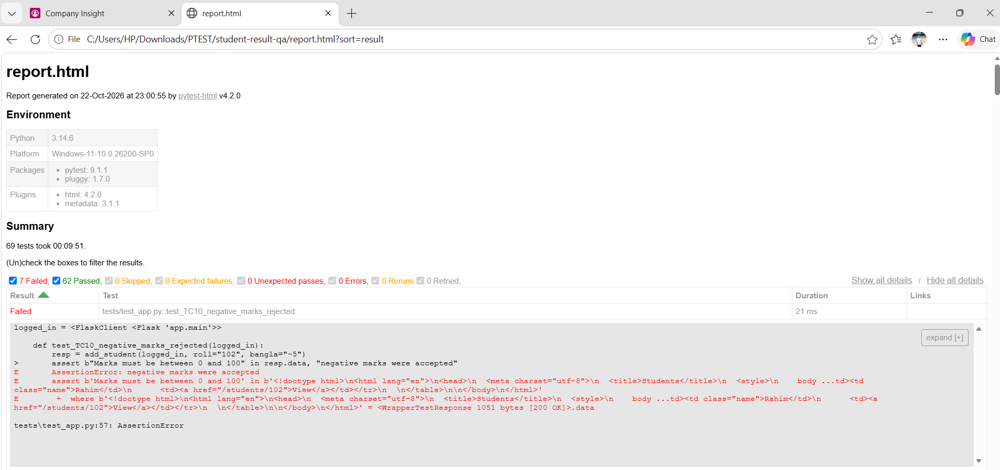
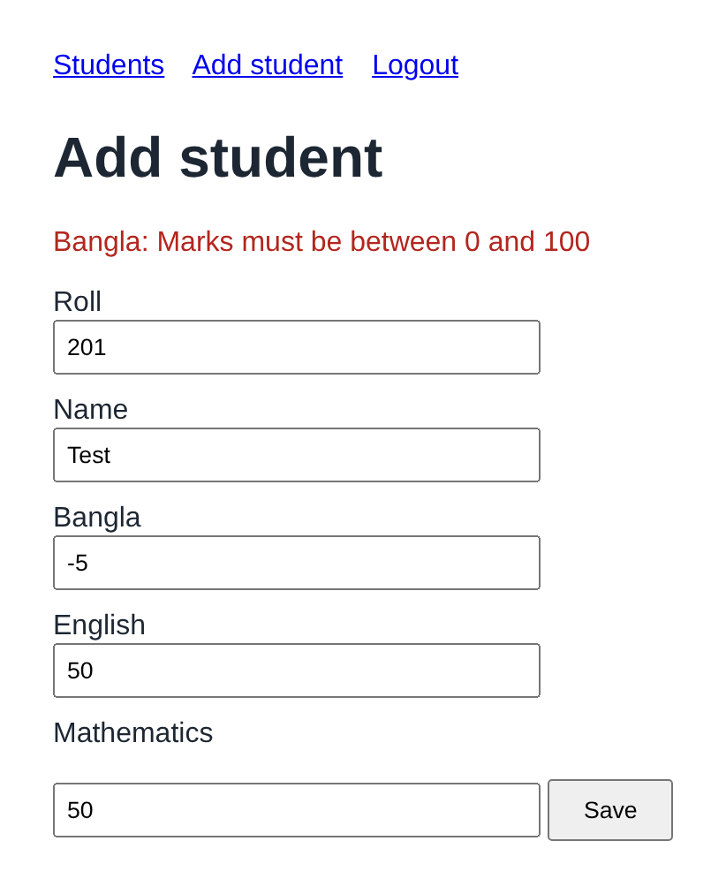
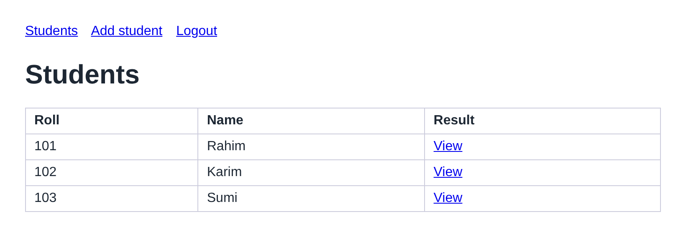
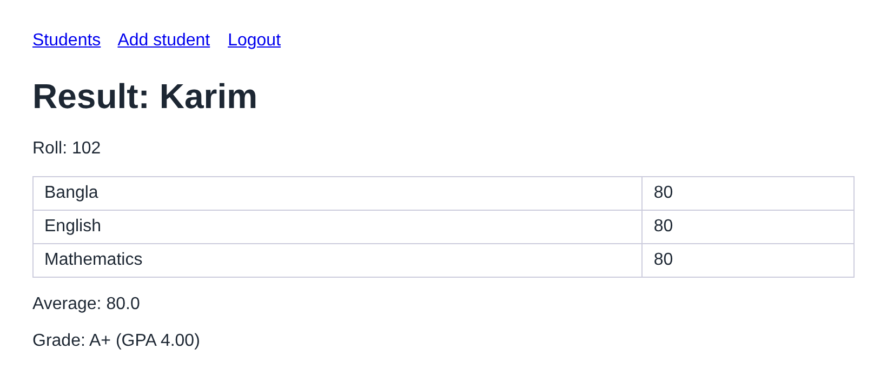

# Student Result System: Software Testing Project

Manual and automated testing of a small **Student Result Management** web app (Flask + SQLite): a test plan, 20 manual test cases, **69 automated tests** with **pytest**, end-to-end UI tests with **Selenium WebDriver** using the Page Object Model, defect analysis, and a CI pipeline configured for Windows and Linux.

The app contained **three real defects**. The tests found them, the defects were fixed, and the full suite was re-run: **69 of 69 tests pass**.

📊 **Presentation:** [presentation.pdf](presentation.pdf)

## Results at a glance

| | Count |
|---|---|
| Automated tests | 69 (48 unit, 15 functional, 6 UI) |
| Manual test cases designed | 20 |
| Passed on first run | 62 |
| Failed on first run | 7 |
| Defects found | 3 |
| Defects fixed and verified | 3 |
| Passed after fixes (regression run) | 69 |



## Defects found

| Bug | What happened | Root cause | Caught by | Severity |
|---|---|---|---|---|
| 1 | An average of exactly 80 got grade **A** instead of **A+** | `avg > 80` instead of `avg >= 80` in `app/grading.py` | Boundary value test `[80-A+]`, TC14 | High |
| 2 | Negative marks such as -5 were accepted and saved | Only the upper limit (`mark > 100`) was checked | Negative tests `[-1]`, `[-50]`, TC10, UI06 | High |
| 3 | Two students could be saved with the same roll | No duplicate check before the database insert in `app/main.py` | TC12 | High |

Fixes: `avg >= 80`; `mark < 0 or mark > 100`; a "Roll already exists" check before saving. After the fixes, all 69 tests pass.

## The application

| Feature | Rules (the specification) |
|---|---|
| Login | `admin` / `admin123`; clear error messages; protected pages redirect to login |
| Add student | Roll and name required; each mark a whole number from 0 to 100; roll must be unique |
| Result | Average of 3 subjects (2 decimals); grade and GPA from the Bangladesh UGC scale in `app/grading.py` |

| Invalid mark rejected | Student list | Result at the 80 boundary |
|---|---|---|
|  |  |  |

## Test design

| Technique | Where | Example |
|---|---|---|
| Boundary Value Analysis | `tests/test_grading.py` | 80 → A+, 79.99 → A, for all 10 grade bands |
| Equivalence Partitioning | `tests/test_grading.py` | One value inside each grade band |
| Negative testing | unit, functional and UI tests | -1, 101, `abc`, empty, 45.5 |
| Regression testing | full suite | Re-run all 69 tests after the fixes |

UI tests use the **Page Object Model** (`tests/ui/pages.py`) and **explicit waits**: after each form submit, the test waits until the next page has loaded.

## Lessons from the test suite

- **A timing failure, not a product bug.** Three UI tests first failed because the browser moved on before login had finished. The server log showed no login request. An explicit wait fixed it.
- **A slow suite.** The HTML report showed three UI tests taking about 3 minutes each: Chrome's extra idle connections blocked the single-threaded test server. Making the test server threaded cut the full run from **10 min 31 s to 30 s**.

## Project structure

```
app/
  main.py              the web application (routes, database)
  grading.py           grading rules (the specification table is at the top)
  templates/           HTML pages
tests/
  test_grading.py      unit tests: boundary values, equivalence partitions, negative cases
  test_app.py          functional tests, one per manual test case (TC01–TC15)
  ui/pages.py          Selenium Page Objects (LoginPage, AddStudentPage, ...)
  ui/test_ui.py        end-to-end browser tests (UI01–UI06)
docs/
  test_plan.md         scope, approach, environments, entry/exit criteria
  test_cases.csv       20 manual test cases (open in Excel)
  bug_report_template.md
  answer_key.md        the known defects and their fixes
  images/              screenshots used in this README
.github/workflows/tests.yml   CI: runs all tests on Ubuntu + Windows, Python 3.10 + 3.12
presentation.pdf       project presentation
```

## Run it yourself

Install [Python 3.10+](https://www.python.org/downloads/) (tick **"Add Python to PATH"**) and [Google Chrome](https://www.google.com/chrome/).

**One click (Windows):** double-click `run_tests.bat` to run all tests and open the HTML report, or `run_app.bat` to start the app. On macOS/Linux use `./run_tests.sh` and `./run_app.sh`.

**Manual setup:**

```bash
python -m venv .venv
.venv\Scripts\activate          # macOS/Linux: source .venv/bin/activate
pip install -r requirements.txt
```

Run the app, then open http://127.0.0.1:5000 and log in with `admin` / `admin123`:

```bash
python -m app.main
```

Run the tests:

```bash
pytest                          # everything: unit + functional + Selenium UI
pytest -m "not ui"              # fast tests only (no browser)
pytest -m ui --headed           # UI tests with the Chrome window visible
pytest --html=report.html --self-contained-html   # HTML report
```

Selenium 4 downloads the matching ChromeDriver automatically.

## Testing process (STLC)

| Phase | What was done | Output |
|---|---|---|
| 1. Requirement analysis | Read the rules and the grading table | List of what must be tested |
| 2. Test planning | Wrote the test plan | `docs/test_plan.md` |
| 3. Test case design | Designed 20 manual test cases | `docs/test_cases.csv` |
| 4. Environment setup | Python, Chrome, VS Code, pytest, Selenium | Working setup |
| 5. Test execution | Ran the 69 automated tests | HTML test report |
| 6. Defect reporting | Grouped 7 failures into 3 defects | Defect table above |
| 7. Fix and retest | Fixed the code and re-ran everything | 69 of 69 passed |
| 8. Test closure | Summarised the results | This README |

## Tools and techniques

Python · pytest · pytest-html · Selenium WebDriver · Page Object Model · Flask test client · GitHub Actions CI · Boundary Value Analysis · Equivalence Partitioning · Negative testing · Regression testing
